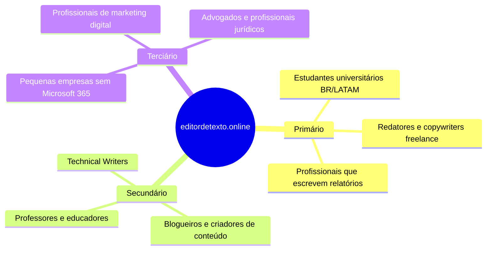
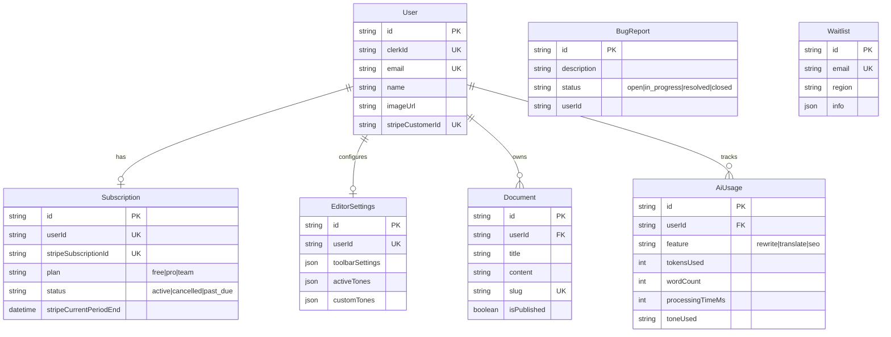
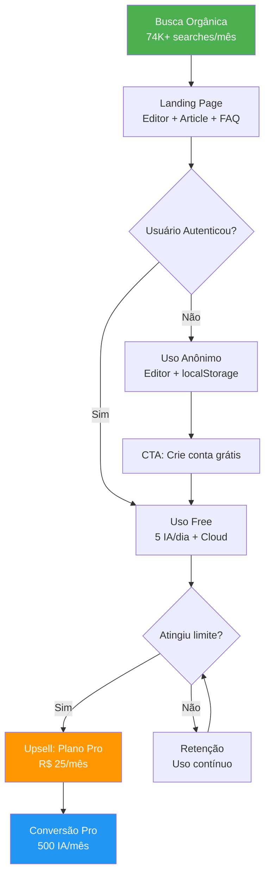

# 📋 Documentação Estratégica do MVP — editordetexto.online

**Versão:** 1.0.0  
**Data:** 23 de Abril de 2026  
**Autores:** Product Manager & Tech Lead (IA-Assisted)  
**Status:** Draft — Aguardando Aprovação do Fundador  

---

## Índice

1. [Visão do Produto & Regras de Negócio](#1-visão-do-produto--regras-de-negócio)
2. [Project DNA — Mapa Tecnológico](#2-project-dna--mapa-tecnológico)
3. [Funcionalidades Atuais (Feature Inventory)](#3-funcionalidades-atuais-feature-inventory)
4. [Oportunidades de Melhoria (PRD)](#4-oportunidades-de-melhoria-prd)
5. [Estratégia de Crescimento & SEO On-Page](#5-estratégia-de-crescimento--seo-on-page)

---

# 1. Visão do Produto & Regras de Negócio

## 1.1 Declaração de Visão

> **Ser o editor de texto online mais acessível e inteligente da América Latina**, combinando a simplicidade do Google Docs com o poder de correção linguística profissional e assistência de IA, sem exigir downloads ou instalações.

## 1.2 Problema que Resolvemos

| Dor do Usuário | Como Resolvemos |
|---|---|
| Necessidade de baixar software pesado (Word) | Editor 100% web, acessível de qualquer dispositivo |
| Corretor ortográfico limitado dos navegadores | Integração profissional com LanguageTool (gramática + estilo) |
| Dificuldade em reescrever textos com qualidade | IA com 14+ tons de reescrita e tradução contextual |
| Perda de dados ao fechar a aba | Auto-save em `localStorage` + persistência em nuvem |
| Ferramentas de IA caras e separadas | Freemium com 5 usos diários gratuitos de IA |

## 1.3 Público-Alvo (ICP — Ideal Customer Profile)



## 1.4 Modelo de Negócio: Freemium Privacy-First

### Matriz de Planos

| Recurso | **Free (Start)** | **Pro (Creator)** | **Team (Business)** |
|:---|:---:|:---:|:---:|
| **Preço** | R$ 0 | R$ 25/mês | R$ 49/usuário |
| Editor Rich Text completo | ✅ | ✅ | ✅ |
| Revisor LanguageTool | ✅ | ✅ | ✅ |
| Modo Código-Fonte (HTML) | ✅ | ✅ | ✅ |
| Exportação PDF/DOCX | ✅ Básica | ✅ Pro | ✅ + Marca d'água |
| **Reescritas IA** | 5/dia (5 tons) | 500/mês (todos tons) | 500/mês + Custom |
| **Traduções IA** | Compartilha cota | 500/mês | 500/mês |
| Armazenamento | Local (browser) | Nuvem Ilimitada | Nuvem Compartilhada |
| Dispositivos | 1 (atual) | Ilimitado (sync) | Ilimitado + Gestão |
| Tons Personalizados | ❌ | Até 5 | Ilimitado |
| Suporte | Comunidade | Prioritário | Gerente de Contas |

### Regras de Negócio Críticas

> [!IMPORTANT]
> **RN-001**: A cota de IA do plano Free é **global** (reescrita + tradução + SEO = 5/dia total). Renovação implícita à 00:00 UTC.

> [!IMPORTANT]
> **RN-002**: Plano Free tem acesso restrito a 5 tons padrão: Formal, Casual, Acadêmico, Criativo e Simplificado. Tentativa de usar outros tons retorna HTTP 403.

> [!IMPORTANT]
> **RN-003**: Limite de payload por requisição de IA: **5.000 caracteres** (validação Zod em todas as rotas `/api/ai/*`).

> [!IMPORTANT]
> **RN-004**: Rate limit global por IP (persistido no PostgreSQL) como camada de segurança adicional, antes da verificação de cota individual.

> [!IMPORTANT]
> **RN-005**: O registro de uso (`db.aiUsage.create`) ocorre **após** o término do streaming da IA. Falha no DB pode permitir uso excedente (bug conhecido, não intencional).

> [!WARNING]
> **RN-006**: Custo de IA por usuário Pro limitado a **$0.80 USD/mês** máximo. Cenário extremo (500 reqs × 5000 chars) = $0.56 USD. Margem segura.

## 1.5 North Star Metric

> **Documentos aprimorados por IA por semana** (Weekly AI-Enhanced Documents)

Essa métrica captura simultaneamente:
- **Engajamento**: Usuário está voltando e usando o editor
- **Valor percebido**: Está utilizando a funcionalidade premium (IA)
- **Monetização**: Proxy direto para conversão Free → Pro

### Métricas Complementares (AARRR)

| Estágio | Métrica | Meta Q3/2026 |
|---|---|---|
| **Acquisition** | Visitantes únicos orgânicos/mês | 50.000 |
| **Activation** | % visitantes que digitam > 100 palavras | 40% |
| **Retention** | % usuários ativos semanais (WAU/MAU) | 25% |
| **Revenue** | MRR (Monthly Recurring Revenue) | R$ 5.000 |
| **Referral** | % usuários que compartilham documento | 5% |

---

# 2. Project DNA — Mapa Tecnológico

## 2.1 Stack Arquitetural

```
┌─────────────────────────────────────────────────────────────┐
│                        FRONTEND                              │
│  Next.js 14 (App Router) + React 18 + TypeScript 5          │
│  ┌──────────────┐  ┌──────────────┐  ┌──────────────┐       │
│  │  Tiptap 3.x  │  │ CodeMirror 6 │  │  Framer      │       │
│  │  (ProseMirror)│  │ (Source Mode)│  │  Motion      │       │
│  └──────────────┘  └──────────────┘  └──────────────┘       │
│  Styling: Tailwind CSS 3.4 + SCSS Modules                    │
│  UI Primitives: Radix UI (Dropdown, Popover, Tooltip)        │
│  Icons: Lucide React + React Icons                           │
│  Charts: Recharts (Dashboard)                                │
│  Toasts: Sonner                                              │
│  Forms: React Hook Form + Zod 4                              │
├─────────────────────────────────────────────────────────────┤
│                      BACKEND (API Routes)                    │
│  ┌──────────────┐  ┌──────────────┐  ┌──────────────┐       │
│  │   Clerk      │  │   Stripe     │  │  Vercel AI   │       │
│  │   (Auth)     │  │  (Payments)  │  │  SDK + GPT-  │       │
│  │              │  │              │  │  4o-mini      │       │
│  └──────────────┘  └──────────────┘  └──────────────┘       │
│  ORM: Prisma 5 → PostgreSQL (Supabase)                       │
│  Rate Limiting: PostgreSQL + Prisma                          │
│  Webhooks: Svix (Clerk events)                               │
├─────────────────────────────────────────────────────────────┤
│                      INFRAESTRUTURA                          │
│  Hosting: Vercel (Edge + Serverless)                         │
│  CDN/Images: Cloudinary                                      │
│  Monitoring: Sentry 10 + Vercel Analytics + Speed Insights   │
│  PWA: Serwist 9 (Service Worker)                             │
│  SEO: next/sitemap + robots.ts + JSON-LD Schema              │
│  3rd Party: Google Tag Manager + Microsoft Clarity            │
└─────────────────────────────────────────────────────────────┘
```

## 2.2 Mapa de Dependências Críticas

| Camada | Dependência | Versão | Função | Risco |
|---|---|---|---|---|
| Editor | `@tiptap/*` | 3.10.1 | Motor do editor WYSIWYG | 🟡 Vendor lock-in |
| Auth | `@clerk/nextjs` | 6.38.0 | Autenticação e sessões | 🟢 Substituível |
| Pagamentos | `stripe` | 20.3.1 | Assinaturas e billing | 🟡 Alto acoplamento |
| IA | `ai` (Vercel SDK) | 6.0.91 | Streaming de respostas LLM | 🟢 Model agnostic |
| IA Model | `@ai-sdk/openai` | 3.0.30 | Conector OpenAI | 🟢 Plugável |
| DB | `@prisma/client` | 5.16.1 | ORM + Migrations | 🟡 Lock-in moderado |
| Rate limit | `@prisma/client` | 5.16.1 | Rate limiting por IP persistido no PostgreSQL | 🟢 Integrado |
| PWA | `@serwist/next` | 9.5.7 | Service Worker + offline | 🟢 Padrão aberto |
| Monitoring | `@sentry/nextjs` | 10.39.0 | Error tracking | 🟢 Substituível |

## 2.3 Estrutura de Banco de Dados



## 2.4 Rotas de API (Backend Endpoints)

| Rota | Método | Função | Auth |
|---|---|---|---|
| `/api/ai/rewrite` | POST | Reescrita de texto com IA | ✅ Clerk |
| `/api/ai/translate` | POST | Tradução contextual | ✅ Clerk |
| `/api/ai/seo` | POST | Análise SEO de conteúdo | ✅ Clerk |
| `/api/languagetool` | POST | Proxy para LanguageTool API | ❌ Público |
| `/api/documents` | GET/POST | CRUD de documentos | ✅ Clerk |
| `/api/images` | POST | Upload para Cloudinary | ✅ Clerk |
| `/api/stripe/webhooks` | POST | Webhooks de pagamento | 🔒 Stripe signature |
| `/api/webhooks/clerk` | POST | Webhooks de autenticação | 🔒 Svix signature |
| `/api/bug-reports` | POST | Reporte de bugs | Opcional |
| `/api/waitlist` | POST | Inscrição na waitlist | ❌ Público |
| `/api/dashboard` | GET | Métricas do dashboard | ✅ Clerk |
| `/api/editor-settings` | GET/PUT | Configurações do editor | ✅ Clerk |
| `/api/user` | GET | Dados do usuário + plano | ✅ Clerk |
| `/api/export-import` | POST | Import de PDF | ✅ Clerk |
| `/api/pdf` | POST | Geração de PDF | ✅ Clerk |
| `/api/cron` | GET | Jobs agendados | 🔒 Cron secret |

---

# 3. Funcionalidades Atuais (Feature Inventory)

## 3.1 Pilar: Editor Rich Text (Core)

| Feature | Status | Detalhe |
|---|---|---|
| Formatação básica | ✅ Prod | Bold, Italic, Underline, Strikethrough, Sub/Superscript |
| Alinhamento | ✅ Prod | Left, Center, Right, Justify |
| Tipografia | ✅ Prod | Font Family, Font Size, Line Height, Text Color, Highlight |
| Estruturação | ✅ Prod | Headers H1-H6, Bullet/Ordered Lists, Blockquote, Divider |
| Tabelas | ✅ Prod | Insert, add/remove rows/cols, headers |
| Links | ✅ Prod | External links com popover de edição |
| Imagens | ✅ Prod | Upload via Cloudinary, legendas, biblioteca de mídia |
| YouTube | ✅ Prod | Embed de vídeos por URL |
| Blocos de código | ✅ Prod | Syntax highlighting via Lowlight/Shiki |
| Search & Replace | ✅ Prod | Busca com highlight + substituição em lote |
| Undo/Redo | ✅ Prod | Histórico completo de operações |

## 3.2 Pilar: Revisão & Qualidade

| Feature | Status | Detalhe |
|---|---|---|
| LanguageTool (Sidebar) | ✅ Prod | Correção gramatical/ortográfica em tempo real |
| LanguageTool (inline) | ✅ Prod | Sublinhado de erros com matching contextual |
| Contagem de palavras | ✅ Prod | Chars, words, tempo de leitura |
| Barra de progresso | ✅ Prod | Progresso de leitura visual |
| Sumário automático (ToC) | ✅ Prod | Gerado a partir dos headings |

## 3.3 Pilar: Inteligência Artificial

| Feature | Status | Detalhe |
|---|---|---|
| Reescrita com IA | ✅ Prod | 14+ tons via GPT-4o-mini, streaming |
| Tradução contextual | ✅ Prod | Preserva formatação, 3 idiomas |
| Tons personalizados | ✅ Prod | Até 5 custom tones (Pro) |
| Dashboard de IA | ✅ Prod | KPIs: tempo economizado, tons mais usados, cota |

## 3.4 Pilar: Persistência & Exportação

| Feature | Status | Detalhe |
|---|---|---|
| Auto-save (localStorage) | ✅ Prod | Persistência local sem login |
| Salvamento em nuvem | ✅ Prod | Documentos no PostgreSQL (logado) |
| Exportação PDF | ✅ Prod | Via API dedicada |
| Exportação DOCX | ✅ Prod | Geração nativa |
| Import de PDF | ✅ Prod | Extração de conteúdo |

## 3.5 Pilar: Modo Desenvolvedor

| Feature | Status | Detalhe |
|---|---|---|
| Source Mode (HTML) | ✅ Prod | CodeMirror 6 com syntax highlighting |
| Comparação de versões | ✅ Prod | Diff visual (verde/vermelho) via lib `diff` |
| Drafts (rascunhos) | ✅ Prod | Até 5 versões por documento |

## 3.6 Pilar: Plataforma & Infraestrutura

| Feature | Status | Detalhe |
|---|---|---|
| Autenticação Clerk | ✅ Prod | Login social + email |
| Assinaturas Stripe | ✅ Prod | Free/Pro com webhooks |
| i18n (PT/EN/ES) | ✅ Prod | App Router baseado em locale |
| Dark/Light Theme | ✅ Prod | Toggle com transição suave |
| PWA | ✅ Prod | Installable + Service Worker (Serwist) |
| Atalhos de teclado | ✅ Prod | Modal de consulta rápida |
| Bug Report | ✅ Prod | Dialog in-app com persistência |
| Waitlist | ✅ Prod | Captura de leads |

## 3.7 Pilar: SEO & Marketing

| Feature | Status | Detalhe |
|---|---|---|
| Landing Page | ✅ Prod | Hero, Problem, Features, Pricing, CTA, Article, FAQ |
| JSON-LD Schema | ✅ Prod | WebApp + FAQPage |
| Sitemap dinâmico | ✅ Prod | Localized com hreflang + x-default |
| robots.ts | ✅ Prod | Disallow `/dashboard/`, `/api/` |
| Metadata localizada | ✅ Prod | Title + Description por locale |
| Artigo SEO inline | ✅ Prod | Conteúdo editorial na homepage |
| Páginas institucionais | ✅ Prod | Sobre, Contato, Privacidade, Termos |
| CSP Headers | ✅ Prod | Content Security Policy configurada |
| Analytics | ✅ Prod | Vercel Analytics + Speed Insights + GTM + Clarity |
| Sentry Monitoring | ✅ Prod | Error tracking em client/server/edge |
| Cookie Consent | ✅ Prod | LGPD/GDPR compliance |

---

# 4. Oportunidades de Melhoria (PRD)

## 4.1 Definição do Escopo

Este PRD documenta as oportunidades de melhoria priorizadas pelo framework **RICE** (Reach × Impact × Confidence / Effort), categorizadas por impacto no negócio.

---

## PRD-001: Internacionalização Completa (i18n 100%)

### Problema
Foram identificados **50+ textos hardcoded** em português espalhados por componentes da UI (toasts, aria-labels, titles, placeholders). Isso degrada a experiência para usuários EN/ES e prejudica o SEO multilíngue.

### Solução Proposta
Migrar todos os textos estáticos para os dicionários de locale em `src/data/`, substituindo strings literais por referências dinâmicas.

### Priorização RICE

| Dimensão | Valor | Justificativa |
|---|---|---|
| **Reach** | 10.000 | Todos os visitantes EN/ES |
| **Impact** | 2x (High) | Afeta UX, SEO, e conversão |
| **Confidence** | 100% (High) | Problema documentado |
| **Effort** | 2 person-weeks | Trabalho mecânico, bem definido |
| **RICE Score** | **10.000** | |

### Critérios de Aceite
- [ ] Zero textos hardcoded em componentes React
- [ ] Audit automatizado no lint para strings literais em JSX
- [ ] QA manual em todos os 3 locales

### Métricas de Sucesso
- Bounce rate de visitantes EN/ES diminui 15%
- Tempo médio na página EN/ES aumenta 20%

---

## PRD-002: Content Hub / Blog SEO Programático

### Problema
A homepage concentra todo o conteúdo SEO. Não há páginas de entrada (Landing Pages) para long-tail keywords como "editor de texto para redação ENEM", "editor de texto online para advogados", "editor de texto com IA para blogs".

### Solução Proposta
Criar um Content Hub com artigos programáticos (Programmatic SEO) gerados a partir de templates, publicados como rotas estáticas do Next.js.

### Estrutura Proposta

```
/blog/
├── editor-de-texto-para-estudantes
├── editor-de-texto-com-corretor-ortografico
├── editor-de-texto-online-gratis
├── como-melhorar-redacao-com-ia
├── editor-de-texto-para-advogados
├── editor-de-texto-en-español-gratis
└── free-online-text-editor-with-ai
```

### Priorização RICE

| Dimensão | Valor | Justificativa |
|---|---|---|
| **Reach** | 30.000 | Tráfego orgânico potencial de long-tail |
| **Impact** | 3x (Massive) | Multiplicador de tráfego orgânico |
| **Confidence** | 80% (Medium) | Depende de qualidade de conteúdo |
| **Effort** | 3 person-weeks | Template + conteúdo + routing |
| **RICE Score** | **24.000** | |

### Critérios de Aceite
- [ ] Mínimo de 15 artigos publicados (5 PT, 5 ES, 5 EN)
- [ ] Cada artigo com > 1.500 palavras, schema Article, e CTA integrado
- [ ] Sitemap atualizado automaticamente
- [ ] Internal linking bidirecional com a homepage

---

## PRD-003: Colaboração em Tempo Real (Real-Time)

### Problema
O editor é single-player. O Google Docs domina o mercado justamente pela colaboração. Para o plano Team, colaboração é condição obrigatória.

### Solução Proposta
Implementar colaboração via Yjs (CRDT) + WebSocket provider, permitindo edição simultânea com cursores em tempo real.

### Priorização RICE

| Dimensão | Valor | Justificativa |
|---|---|---|
| **Reach** | 5.000 | Equipes pequenas e freelancers |
| **Impact** | 3x (Massive) | Desbloqueia plano Team e retenção |
| **Confidence** | 50% (Low) | Complexidade alta, requer infra |
| **Effort** | 8 person-weeks | Backend + OT/CRDT + UI |
| **RICE Score** | **937** | |

> [!NOTE]
> Feature estratégica de médio prazo. Exige investimento significativo mas é o principal diferenciador competitivo.

---

## PRD-004: Escrita Assistida (Ghostwriter/Autocomplete)

### Problema
Competidores como Notion AI e Jasper oferecem autocomplete inline. Nosso editor só oferece reescrita pós-composição.

### Solução Proposta
Implementar autocomplete inline estilo GitHub Copilot usando o Vercel AI SDK (`useCompletion`), ativado com `Tab` ou `Ctrl+Space`.

### Priorização RICE

| Dimensão | Valor | Justificativa |
|---|---|---|
| **Reach** | 15.000 | Todos os usuários que produzem conteúdo |
| **Impact** | 2x (High) | Wow factor + productividade |
| **Confidence** | 80% (Medium) | Vercel AI SDK tem exemplo pronto |
| **Effort** | 2 person-weeks | Hook + Tiptap extension + API |
| **RICE Score** | **12.000** | |

---

## PRD-005: SEO & Análise de Legibilidade (Painel Lateral)

### Problema
Redatores e profissionais de marketing precisam otimizar conteúdo para SEO. Atualmente, não há feedback em tempo real sobre legibilidade, densidade de keywords, ou heading structure.

### Solução Proposta
Sidebar de análise SEO em tempo real com score de legibilidade (Flesch-Kincaid adaptado para PT/ES), análise de headings, keyword density, e sugestões de melhoria via LLM.

### Priorização RICE

| Dimensão | Valor | Justificativa |
|---|---|---|
| **Reach** | 8.000 | Marketers e redatores profissionais |
| **Impact** | 2x (High) | Diferenciador vs. Google Docs |
| **Confidence** | 80% (Medium) | Análise local + LLM complementar |
| **Effort** | 3 person-weeks | Análise local + sidebar UI + API |
| **RICE Score** | **4.267** | |

---

## PRD-006: Transcrição de Áudio para Texto

### Problema
Criar conteúdo a partir de reuniões, aulas ou gravações requer transcrição manual.

### Solução Proposta
Upload de áudio → transcrição via OpenAI Whisper → formatação automática com GPT → inserção no editor.

### Priorização RICE

| Dimensão | Valor | Justificativa |
|---|---|---|
| **Reach** | 3.000 | Podcast producers, estudantes, executivos |
| **Impact** | 3x (Massive) | "Wow factor" mais alto do roadmap |
| **Confidence** | 80% (Medium) | APIs maduras (Whisper) |
| **Effort** | 2 person-weeks | Upload handler + API + UI |
| **RICE Score** | **3.600** | |

---

## 4.2 Roadmap Priorizado (RICE Ranked)

| Prioridade | PRD | RICE | Horizonte | Tipo |
|---|---|---|---|---|
| 🥇 1 | **Content Hub / Blog SEO** | 24.000 | Q2 2026 | Growth |
| 🥈 2 | **Autocomplete (Ghostwriter)** | 12.000 | Q2 2026 | Product |
| 🥉 3 | **i18n Completa** | 10.000 | Q2 2026 | Quality |
| 4 | SEO & Legibilidade | 4.267 | Q3 2026 | Product |
| 5 | Transcrição de Áudio | 3.600 | Q3 2026 | Product |
| 6 | Colaboração Real-Time | 937 | Q4 2026 | Strategic |

### Matriz Valor × Esforço

```
                    Baixo Esforço           Alto Esforço
                    
Alto               QUICK WINS              BIG BETS
Valor              ┌──────────────────┐     ┌──────────────────┐
                   │ i18n 100%        │     │ Content Hub/Blog │
                   │ Ghostwriter      │     │ Colaboração RT   │
                   └──────────────────┘     └──────────────────┘
                    
Baixo              FILL-INS                TIME SINKS
Valor              ┌──────────────────┐     ┌──────────────────┐
                   │ SEO Panel        │     │ White-label API  │
                   │ Audio Transcript │     │                  │
                   └──────────────────┘     └──────────────────┘
```

---

# 5. Estratégia de Crescimento & SEO On-Page

## 5.1 Diagnóstico Atual

| Métrica | Status |
|---|---|
| SEO Health Index | **95/100** (Excelente) |
| Indexação | ✅ Todas as rotas indexadas com hreflang |
| Schema.org | ✅ WebApp + FAQPage (Rich Results elegíveis) |
| Core Web Vitals | 🟡 Monitorar INP (dynamic imports do editor) |
| Sitemap | ✅ Dinâmico com alternates |
| Mobile | ✅ Responsivo + PWA |
| i18n | 🟡 Parcial (~80% internacionalizado) |

### Posição Competitiva Atual

| Keyword | Volume Mensal (BR) | Posição Atual | Meta |
|---|---|---|---|
| `editor de texto online` | 74.000 | #4-7 | **Top 3** |
| `editor de texto online grátis` | 22.000 | #5-8 | **Top 3** |
| `editor de texto com IA` | 8.100 | #3-5 | **#1** |
| `editor de texto online` (ES) | 33.000 | #8-12 | **Top 5** |
| `corrector ortográfico online` | 12.000 | N/R | **Top 10** |

---

## 5.2 Estratégia SEO On-Page (Plano de 90 Dias)

### Fase 1: Fundação (Dias 1-30)

#### 1.1 Completar Internacionalização (PRD-001)
- Impacto direto em queries ES/EN
- Corrige sinais negativos de experiência do usuário para Googlebot

#### 1.2 Otimização de Title Tags por Intent

| Página | Title Atual (estimado) | Title Proposto |
|---|---|---|
| **Home PT** | Editor de Texto Online | Editor de Texto Online Grátis com IA e Corretor — editordetexto.online |
| **Home EN** | Online Text Editor | Free Online Text Editor with AI & Grammar Check — editordetexto.online |
| **Home ES** | Editor de Texto en Línea | Editor de Texto Online Gratis con IA y Corrector — editordetexto.online |
| **Sobre** | Sobre | Sobre o Editor de Texto Online — Quem Somos e Nossa Missão |
| **Contato** | Contato | Contato — Fale com o Editor de Texto Online |

#### 1.3 Enriquecimento de Schema.org

**Adicionar schemas faltantes:**

```json
{
  "@type": "SoftwareApplication",
  "name": "Editor de Texto Online",
  "applicationCategory": "ProductivityApplication",
  "operatingSystem": "Web Browser",
  "offers": {
    "@type": "Offer",
    "price": "0",
    "priceCurrency": "BRL"
  },
  "aggregateRating": {
    "@type": "AggregateRating",
    "ratingValue": "4.8",
    "ratingCount": "150"
  }
}
```

**Adicionar schemas de autor e organização para E-E-A-T:**

```json
{
  "@type": "Organization",
  "name": "editordetexto.online",
  "url": "https://editordetexto.online",
  "founder": {
    "@type": "Person",
    "name": "Anderson Leite"
  }
}
```

#### 1.4 Alt Text Audit
- Revisar todos os `next/image` para alt text descritivo e keyword-rich
- Especialmente `LandingHero` e `LandingFeatures`

#### 1.5 Internal Linking Optimizado
- Footer: links para Sobre, Contato, Privacidade, Termos
- Landing sections: cross-links entre features e CTA
- Breadcrumbs em páginas institucionais

---

### Fase 2: Conteúdo Programático (Dias 31-60)

#### 2.1 Content Hub (PRD-002)

**Keywords alvos por cluster:**

| Cluster | Keywords Long-Tail | Volume Combo |
|---|---|---|
| **Educação** | editor de texto para redação ENEM, editor para TCC, editor de texto acadêmico | 12.000 |
| **Profissional** | editor de texto para advogados, editor de texto para médicos, editor de texto para RH | 8.000 |
| **IA** | editor de texto com inteligência artificial, IA para escrever textos, melhorar textos com IA | 15.000 |
| **Grátis** | editor de texto online grátis, editor de texto sem cadastro, editor de texto sem baixar | 35.000 |
| **Comparação** | alternativa ao Google Docs, alternativa ao Word Online, melhor editor de texto online | 6.000 |

#### 2.2 Template de Artigo SEO

Cada artigo deve conter:

```markdown
## Estrutura Obrigatória

1. Title Tag: Keyword principal + modificador (ex: "grátis", "com IA")
2. Meta Description: 150-160 chars com CTA implícito
3. H1: Variação do title com contexto
4. Introdução: 100-150 palavras, keyword nos primeiros 100 chars
5. Subtopics (H2/H3): 4-6 seções cobrindo intent informacional
6. CTA inline: "Experimente agora" com link para editor
7. FAQ Section: 3-5 perguntas com schema FAQPage
8. Author bio: Credenciais para E-E-A-T
9. Last Updated: Timestamp visível
10. Internal links: Min. 3 links para outras páginas
```

#### 2.3 FAQ Expansion
- Adicionar 10-15 FAQs por locale na homepage
- Cada FAQ deve responder uma query long-tail específica

---

### Fase 3: Autoridade & GEO (Dias 61-90)

#### 3.1 Estratégia de Backlinks Orgânicos (Zero Orçamento)

| Canal | Ação | Links Estimados |
|---|---|---|
| Diretórios SaaS | Product Hunt, AlternativeTo, Capterra, G2 | 8-12 |
| Comunidades | Reddit r/webdev, r/productivity, Stack Overflow, TabNews | 5-8 karma links |
| Medium/Dev.to | Artigos técnicos sobre Tiptap, ProseMirror, Next.js | 3-5 |
| GitHub | Contribuições open-source, READMEs com link | 2-3 |
| Quora/Yahoo Respostas | Respostas a perguntas sobre editores online | 5-8 |

#### 3.2 Generative Engine Optimization (GEO)

**Objetivo:** Ser citado por ChatGPT, Claude, Perplexity e Gemini quando usuários perguntam "melhor editor de texto online".

**Ações GEO:**

| Ação | Implementação |
|---|---|
| **Estatísticas originais** | Publicar dados de uso anônimos: "X mil textos revisados por mês" |
| **Definições claras** | Seção "O que é um editor de texto online?" com parágrafo citável |
| **Comparações estruturadas** | Tabela: editordetexto vs Google Docs vs Word Online |
| **FAQ expandido** | Respostas diretas em formato de "snippet zero" |
| **Timestamps** | Exibir "Última atualização: [data]" em todas as páginas |
| **Author schema** | Person schema com credenciais do fundador |
| **Source diversity** | Presença em 10+ fontes externas rastreáveis |

**Configuração de robots.txt para AI Crawlers:**

```txt
# AI Search Engines - ALLOW para ser citado
User-agent: GPTBot
Allow: /

User-agent: Claude-Web
Allow: /

User-agent: PerplexityBot
Allow: /

User-agent: Googlebot
Allow: /
```

#### 3.3 Métricas de SEO a Monitorar

| Métrica | Ferramenta | Frequência | Meta 90 dias |
|---|---|---|---|
| Posições de keyword | Google Search Console | Semanal | Top 3 para 3 keywords |
| Impressões orgânicas | GSC | Semanal | +100% vs baseline |
| CTR médio | GSC | Quinzenal | > 5% |
| Páginas indexadas | GSC | Mensal | +15 (blog) |
| Core Web Vitals (field) | CrUX / PSI | Mensal | LCP < 2.5s, INP < 200ms |
| Citações em AI | Manual (ChatGPT, Perplexity) | Mensal | ≥ 1 citação |
| Backlinks | GSC / Ahrefs Free | Mensal | +20 referring domains |

---

## 5.3 Funil de Conversão SEO → Revenue



---

## 5.4 Decision Log

| # | Decisão | Alternativas | Justificativa |
|---|---|---|---|
| D-001 | Priorizar Content Hub sobre Colaboração RT | Inverter a ordem | Content Hub tem ROI mais rápido (3x RICE) e não exige infra nova |
| D-002 | Usar Programmatic SEO (templates) vs. Editorial | Blog editorial manual | Templates escaláveis para 3 idiomas; editorial não escala |
| D-003 | GEO como camada adicional (não substitui SEO) | Substituir SEO por GEO | SEO ainda gera 90%+ do tráfego orgânico; GEO é complementar |
| D-004 | Manter GPT-4o-mini como modelo principal | Migrar para Claude Sonnet | Custo 10x menor; qualidade suficiente para reescrita |
| D-005 | Allow AI crawlers (GPTBot, etc.) | Block por padrão | Citação em AI search é canal de aquisição emergente |
| D-006 | Limite Free de 5/dia (não 10) | 10/dia ou 3/dia | 5 é suficiente para experimentar valor; 10 erode conversão Pro |

---

## Apêndice: Assumptions

| # | Assumption | Impacto se Incorreta |
|---|---|---|
| A-001 | Volume de "editor de texto online" no BR é ~74K/mês | Redimensionar expectativa de tráfego |
| A-002 | Usuários convertem Free→Pro em 2-3% | Ajustar pricing ou features do Free |
| A-003 | Custo de IA por usuário Pro < $0.80/mês | Revisar limites ou modelo |
| A-004 | Next.js 14 App Router é estável para SSG de blog | Considerar migração para 15 se necessário |
| A-005 | LanguageTool API continuará gratuita para uso moderado | Avaliar self-hosting ou alternativa |
| A-006 | Mercado hispânico aceita mesmo produto que BR | Adaptação cultural pode ser necessária |

---

> [!CAUTION]
> Este documento é um draft estratégico. As projeções de tráfego, conversão e receita são estimativas baseadas em benchmarks de mercado e devem ser validadas com dados reais do Google Search Console e analytics.

---

**Próximo Passo:** Aprovação do fundador → Criação de tasks no backlog → Início da execução da Fase 1.
