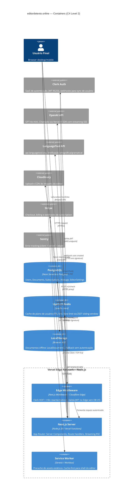
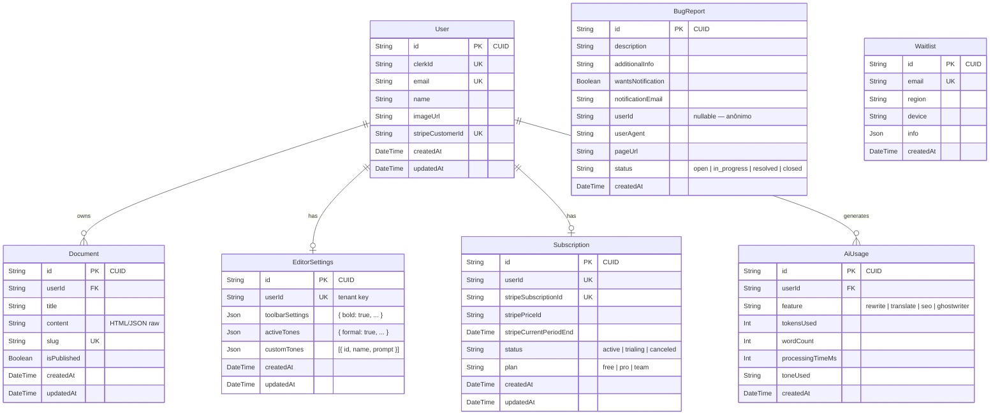

# ARCHITECTURE.md — editordetexto.online

> **Versão:** 1.1.0 · **Stack:** Next.js 14 (App Router) · Tiptap v3.10 · CodeMirror 6 · Clerk v6.38 · Prisma v5.16 · Upstash Redis · Vercel AI SDK v6

---

## Índice

1. [Visão Sistêmica](#1-visão-sistêmica)
2. [Árvore de Diretórios](#2-árvore-de-diretórios)
3. [C4 Model — Nível de Contêiner](#3-c4-model--nível-de-contêiner)
4. [Anatomia do Editor (Core)](#4-anatomia-do-editor-core)
5. [Estratégia de Persistência](#5-estratégia-de-persistência)
6. [Camada de Autenticação e Rate Limit](#6-camada-de-autenticação-e-rate-limit)
7. [Pipeline de IA](#7-pipeline-de-ia)
8. [Esquema de Banco de Dados](#8-esquema-de-banco-de-dados)
9. [PWA e Service Worker](#9-pwa-e-service-worker)
10. [Fluxo de Internacionalização (i18n)](#10-fluxo-de-internacionalização-i18n)
11. [Decisões Técnicas e Tradeoffs](#11-decisões-técnicas-e-tradeoffs)

---

## 1. Visão Sistêmica

O projeto é uma **SaaS de editor de texto rico** com modelo freemium (Free → Pro). A arquitetura é deliberadamente um **monolito modular** hospedado na Vercel: sem microserviços separados. Cada "serviço" (IA, gramática, PDFs, Stripe) é um Route Handler Next.js isolado, protegido por middleware Clerk no Edge Runtime.

**Princípios arquiteturais não-negociáveis:**

| Princípio | Implementação concreta |
|---|---|
| **Offline-first** | `localStorage` como fonte primária de verdade + sync para Postgres quando autenticado |
| **Edge-compatible middleware** | `src/middleware.ts` roda no Cloudflare Edge (sem Node.js APIs); i18n e Clerk coexistem sem `next-intl` |
| **Multi-tenant por isolamento de dados** | Toda query ao Prisma filtra por `userId` extraído do Clerk token; sem RLS no Postgres |
| **Degradação graceful** | Redis offline → fallback para DB; LanguageTool timeout → editor continua funcional |
| **Separação WYSIWYG/Source** | Tiptap (ProseMirror) e CodeMirror 6 são instâncias totalmente separadas; sincronização explícita via HTML string |

---

## 2. Árvore de Diretórios

```
editordetexto/                         ← Raiz do monorepo
├── prisma/
│   ├── schema.prisma                  ← Definição de modelos (User, Document, Subscription, AiUsage…)
│   └── migrations/                    ← Histórico incremental de DDL
│
├── public/                            ← Ativos estáticos (ícones PWA, og-images)
│
├── src/
│   ├── middleware.ts                   ← Edge Runtime: Clerk HOF + i18n rewrite/redirect
│   ├── middleware.test.ts
│   ├── instrumentation.ts             ← Sentry SDK init (Node + Edge)
│   │
│   ├── app/                           ← Next.js App Router root
│   │   ├── layout.tsx                 ← Root layout: ClerkProvider, ThemeProvider, Toaster, Analytics
│   │   ├── manifest.ts                ← PWA manifest dinâmico
│   │   ├── sw.ts                      ← Serwist Service Worker (precache + runtimeCaching)
│   │   ├── robots.ts / sitemap.ts     ← SEO automático
│   │   │
│   │   ├── [locale]/                  ← Segmento dinâmico de locale (pt | en | es)
│   │   │   ├── page.tsx               ← Landing page (SSR, i18n, seções de pricing)
│   │   │   ├── style.scss             ← Estilos do [locale] (24 KB — landing + editor)
│   │   │   ├── loading.tsx            ← Suspense boundary da rota
│   │   │   ├── (auth)/                ← Grupo de rota: sign-in / sign-up (Clerk hosted)
│   │   │   ├── dashboard/
│   │   │   │   ├── page.tsx           ← Server Component: getCurrentUser → hydration
│   │   │   │   ├── DashboardContent.tsx ← Client Component: lista documentos, uso de IA
│   │   │   │   └── _components/       ← Subcomponentes do dashboard (cards, charts Recharts)
│   │   │   ├── settings/              ← Configurações do editor (toolbar visibility, tones)
│   │   │   ├── contato/               ← Formulário de contato
│   │   │   ├── sobre/ privacidade/ termos/
│   │   │   └── _components/           ← Componentes exclusivos da rota [locale]
│   │   │
│   │   └── api/                       ← Route Handlers (Node.js Runtime, não Edge)
│   │       ├── ai/
│   │       │   ├── rewrite/route.ts   ← streaming: Vercel AI SDK → OpenAI GPT-4o-mini
│   │       │   ├── translate/route.ts
│   │       │   ├── seo/route.ts
│   │       │   └── ghostwriter/route.ts
│   │       ├── documents/route.ts     ← CRUD documentos (GET, POST, DELETE)
│   │       ├── editor-settings/route.ts ← GET/PATCH toolbarSettings, activeTones
│   │       ├── languagetool/route.ts  ← Proxy para api.languagetool.org (rate-limited)
│   │       ├── images/route.ts        ← Upload Cloudinary
│   │       ├── pdf/route.ts           ← Geração de PDF (Puppeteer-less: HTML → resposta)
│   │       ├── export-import/route.ts ← DOCX / TXT / Markdown export
│   │       ├── stripe/                ← Checkout e Customer Portal
│   │       ├── webhooks/              ← Clerk webhook (user.created/deleted) + Stripe webhook
│   │       ├── user/route.ts          ← Sync e metadata do usuário
│   │       ├── dashboard/route.ts     ← Métricas agregadas de uso
│   │       ├── bug-reports/route.ts
│   │       ├── waitlist/route.ts
│   │       └── cron/route.ts          ← Jobs agendados (limpeza, relatórios)
│   │
│   ├── components/
│   │   ├── TiptapEditor/              ← WYSIWYG core — isolado e auto-suficiente
│   │   │   ├── index.ts               ← Barrel export
│   │   │   ├── kit.ts                 ← createExtensionKit(locale): array de extensions configuradas
│   │   │   ├── extensions/
│   │   │   │   ├── index.ts           ← Re-exporta todas as extensions
│   │   │   │   ├── LanguageTool.ts    ← ProseMirror Plugin com DecorationSet + fetch debounced
│   │   │   │   ├── SearchAndReplace.ts ← Plugin de busca/substituição inline
│   │   │   │   ├── Shortcuts.ts       ← Keyboard shortcuts declarativos
│   │   │   │   ├── Image/             ← Upload + resize drag
│   │   │   │   ├── ImageFigure/       ← <figure><figcaption>
│   │   │   │   ├── CodeBlock/         ← lowlight syntax highlighting
│   │   │   │   ├── Table/             ← Table resize + cell merge
│   │   │   │   ├── Youtube/           ← Embed iframe
│   │   │   │   ├── FontSize.ts
│   │   │   │   ├── LineHeight.ts
│   │   │   │   ├── Indent.ts
│   │   │   │   ├── TextCase.ts
│   │   │   │   ├── Link.ts
│   │   │   │   ├── Selection.ts
│   │   │   │   └── Figcaption.ts
│   │   │   ├── components/
│   │   │   │   ├── Provider.tsx       ← TiptapContext: EditorProvider + estado compartilhado
│   │   │   │   ├── Editor.tsx         ← EditorContent wrapper (<div contenteditable>)
│   │   │   │   ├── MenuBar.tsx        ← Toolbar: botões mapeados por toolbarSettings
│   │   │   │   ├── BubbleMenu.tsx     ← Menu flutuante na seleção
│   │   │   │   ├── SideBar.tsx        ← Painel lateral (TOC, LanguageTool issues)
│   │   │   │   ├── StatusBar.tsx      ← Rodapé: word count, chars, status LT
│   │   │   │   ├── LanguageToolSidebar.tsx ← Lista de erros gramaticais clicáveis
│   │   │   │   ├── Resizer.tsx        ← Handle para resize do painel lateral
│   │   │   │   ├── TableBuilder.tsx
│   │   │   │   └── controls/ menus/ color-picker/ icons/ ui/
│   │   │   ├── hooks/
│   │   │   │   ├── useTiptapEditor.ts ← Composable: inicializa Editor com createExtensionKit
│   │   │   │   ├── useAiRewrite.ts    ← useCompletion(@ai-sdk/react) → /api/ai/rewrite
│   │   │   │   ├── useModal.ts
│   │   │   │   ├── useThrottle.ts
│   │   │   │   ├── useCopyToClipboard.ts
│   │   │   │   ├── useForceUpdate.ts
│   │   │   │   └── useMount.ts
│   │   │   ├── constants/             ← Mapas de cores, fontes, tamanhos disponíveis
│   │   │   ├── i18n/                  ← Dicionários de rótulos do editor (pt/en/es)
│   │   │   ├── styles/                ← editor.scss (tipografia, decorações LT, tema)
│   │   │   └── utils/                 ← getEditorLocale, htmlToText, etc.
│   │   │
│   │   ├── SourceEditor/              ← Modo HTML / Source View
│   │   │   ├── Editor.tsx             ← Wrapper React: monta div e entrega ao useCodeMirror
│   │   │   ├── useCodeMirror.ts       ← EditorState + EditorView (read-only, html(), lineNumbers)
│   │   │   ├── format.ts              ← Prettify HTML (js-beautify wrapper)
│   │   │   ├── theme.ts               ← Tema CodeMirror customizado (dark/light)
│   │   │   └── CodeMirror.scss
│   │   │
│   │   ├── MediaLibrary/              ← Browser de imagens Cloudinary
│   │   ├── TiptapRenderer/            ← Server-side: renderiza HTML salvo via rehype-react
│   │   ├── Cloudinary/                ← Upload widget
│   │   ├── dashboard/                 ← Componentes de dashboard (charts, doc cards)
│   │   ├── landing/                   ← Hero, Features, Pricing sections
│   │   ├── auth/                      ← Wrappers de autenticação Clerk
│   │   ├── providers/                 ← ThemeProvider, QueryClientProvider
│   │   ├── Footer/
│   │   └── shared/                    ← Button, Modal, Spinner, Tooltip (Radix)
│   │
│   ├── lib/                           ← Utilitários server-side puros
│   │   ├── db.ts                      ← Singleton PrismaClient (global cache em dev)
│   │   ├── redis.ts                   ← Singleton ioredis
│   │   ├── auth.ts                    ← getCurrentUser() + getUserPlan() com React.cache + Redis
│   │   ├── ratelimit.ts               ← SlidingWindowRatelimit via ZSET Redis
│   │   ├── ai-rate-limit.ts           ← Limite diário (free) + mensal (pro) via AiUsage table
│   │   ├── ai-sanitize.ts             ← DOMPurify server-side (isomorphic-dompurify)
│   │   ├── local-storage.ts           ← CRUD de LocalDocument[] no localStorage
│   │   ├── sync-user.ts               ← on-the-fly Clerk → Prisma user sync
│   │   ├── stripe.ts                  ← Stripe SDK singleton
│   │   ├── localeRoutes.ts            ← Mapa de rotas por locale
│   │   └── *.test.ts                  ← Testes unitários Vitest colocados
│   │
│   ├── hooks/                         ← Hooks globais (nível app)
│   │   ├── useProgress.ts             ← NProgress-style page loading
│   │   └── useToc.ts                  ← Extrai headings do documento para TOC
│   │
│   ├── services/
│   │   └── post.ts                    ← Service de documentos (abstração sobre fetch + localStorage)
│   │
│   ├── data/                          ← Dados estáticos: tones, AI prompts, planos de pricing
│   ├── types/                         ← Tipos TypeScript compartilhados (languageTool.d.ts…)
│   ├── styles/
│   │   └── globals.scss               ← Design tokens, reset, utilitários globais
│   └── utils/                         ← Helpers puros: formatDate, slugify, cn()
│
├── types/                             ← @types globais (declarações de módulo)
├── cypress/                           ← Testes E2E (Cypress 15)
├── tests/                             ← Testes de build e integração
├── i18n-config.ts                     ← { locales: ['pt','en','es'], defaultLocale: 'pt' }
├── next.config.mjs                    ← CSP headers, withSerwist, redirects
├── tailwind.config.js                 ← Tailwind + @tailwindcss/typography
├── sentry.{client,server,edge}.config.ts
└── vitest.config.ts
```

**Justificativa da organização:**

| Decisão | Razão |
|---|---|
| `TiptapEditor/` auto-contido | Extensions, hooks, i18n e estilos do editor vivem juntos. Não vaza nada para `src/components/shared`. Permite extrair como pacote NPM no futuro. |
| `lib/` apenas server-side | Nenhum arquivo em `lib/` importa `"use client"`. São utilitários puros para Route Handlers e Server Components. |
| `[locale]/` como segmento dinâmico | Evita `next-intl` e suas complexidades de build. O middleware faz rewrite/redirect sem biblioteca. Locale default (`pt`) usa rewrite → URL canônica sem prefixo. |
| `api/` plano (sem subpastas profundas) | Cada domínio tem um `route.ts` na profundidade 1. Evita hierarquias que dificultam refatoração. |
| Testes colocados (`*.test.ts`) | Testes unitários vivem ao lado do módulo testado em `lib/`. Testes E2E ficam em `cypress/`. |

---

## 3. C4 Model — Nível de Contêiner

### 3.1 Diagrama Mermaid



### 3.2 Tabela de Contêineres

| Contêiner | Runtime | Responsabilidade | Acesso a dados |
|---|---|---|---|
| **Edge Middleware** | Cloudflare Edge (V8) | Validação JWT Clerk, i18n rewrite/redirect, bloqueio de rotas protegidas | Somente JWKS Clerk — **zero DB** |
| **Next.js Server** | Node.js 20 (Vercel Function, 60s timeout) | Server Components, Route Handlers, streaming AI, exports | Postgres via Prisma, Redis via ioredis |
| **Service Worker** | Browser (Serwist/Workbox) | Precache shell PWA, cache-first para assets, offline fallback | Cache API + LocalStorage |
| **PostgreSQL** | Neon Serverless | Persistência durável de documentos, usuários, planos, uso de IA | — |
| **Upstash Redis** | Redis 7 (TLS) | Cache de `getUserPlan()` (TTL 5min), rate limit sliding window | — |
| **LocalStorage** | Browser | Documentos offline de usuários não autenticados ou sem conexão | — |

---

## 4. Anatomia do Editor (Core)

O editor é composto por **duas instâncias totalmente independentes**: Tiptap (WYSIWYG) e CodeMirror 6 (Source). Elas **não compartilham estado reativo** — a sincronização é explícita e unidirecional, disparada pelo usuário ao alternar modos.

### 4.1 Tiptap (WYSIWYG)

```
TiptapContext (Provider.tsx)
│
├── EditorProvider (@tiptap/react)
│   └── useEditor({
│         extensions: createExtensionKit(locale),  ← kit.ts
│         content: initialHTML,
│         onUpdate: ({ editor }) => throttledAutoSave(editor.getHTML())
│       })
│
├── Estado compartilhado via TiptapContext:
│   ├── editor: Editor                  ← instância ProseMirror
│   ├── activeTones: string[]
│   ├── toolbarSettings: Record<string, boolean>
│   └── isSourceMode: boolean           ← flag de modo atual
│
└── Extensions (kit.ts → createExtensionKit):
    ├── StarterKit (doc, paragraph, heading, bold, italic, strike, blockquote, list…)
    ├── LanguageTool     ← ProseMirror Plugin customizado (ver §4.3)
    ├── SearchAndReplace ← Plugin de highlight + replace
    ├── CharacterCount   ← Conta palavras/chars para StatusBar
    ├── Image + ImageUpload + ImageFigure ← upload → Cloudinary
    ├── CodeBlock (lowlight) ← syntax highlighting server-rendered
    ├── Table (com resize de colunas)
    ├── Youtube (iframe embed)
    ├── Link, FontFamily, FontSize, LineHeight, Color, Highlight, TextAlign
    ├── Subscript, Superscript, TextCase, Indent
    ├── Selection (custom mark para highlight de seleção)
    ├── Shortcuts (atalhos declarativos via keymap)
    └── Placeholder (context-aware: paragraph vs caption)
```

### 4.2 CodeMirror 6 (Source Mode)

O `SourceEditor/` é um componente **completamente desacoplado** do Tiptap:

```
SourceEditor/Editor.tsx
│
└── useCodeMirror({ initialContent: editor.getHTML() })
    │
    ├── EditorState.create({
    │     doc: initialContent,          ← HTML string do Tiptap no momento da abertura
    │     extensions: [
    │       lineNumbers(),
    │       html(),                     ← @codemirror/lang-html: parser + highlighting
    │       theme,                      ← tema customizado (dark/light)
    │       EditorState.readOnly.of(true), ← SOMENTE LEITURA (v1.1.0)
    │       EditorView.lineWrapping
    │     ]
    │   })
    │
    └── EditorView({ state, parent: divRef.current })
```

### 4.3 Sincronização Tiptap ↔ CodeMirror

A sincronização **não é reativa/bidirecional**. É um padrão **snapshot-on-open**:

```
┌─────────────────────────────────────────────────────────┐
│                  Alternância de Modo                    │
├─────────────────────────────────────────────────────────┤
│                                                         │
│  [WYSIWYG → Source]                                     │
│  1. Usuário clica "Ver HTML"                            │
│  2. Provider.tsx seta isSourceMode = true               │
│  3. SourceEditor monta com initialContent=editor.getHTML()│
│     → CodeMirror recebe HTML serializado do ProseMirror │
│  4. Tiptap permanece montado (hidden via CSS display:none)│
│     → Estado ProseMirror intacto na memória             │
│                                                         │
│  [Source → WYSIWYG]                                     │
│  1. Usuário clica "Ver Editor"                          │
│  2. Provider.tsx seta isSourceMode = false              │
│  3. SourceEditor desmonta (useEffect cleanup destrói    │
│     EditorView → sem memory leak)                       │
│  4. Tiptap exibe o conteúdo que estava em memória       │
│     → NÃO lê o HTML editado no CodeMirror               │
│                                                         │
│  ⚠️  LIMITAÇÃO ATUAL (v1.1.0):                          │
│  CodeMirror está em modo read-only. Edições no Source   │
│  não são propagadas de volta ao Tiptap. A sincronização │
│  bidirecional completa é um item do roadmap.            │
└─────────────────────────────────────────────────────────┘
```

### 4.4 LanguageTool Extension — Fluxo Técnico Detalhado

A extension `LanguageTool.ts` implementa um ProseMirror Plugin com um ciclo de vida controlado:

```
Usuário digita
      │
      ▼
plugin.view.update()          ← chamado a cada transação ProseMirror
      │
      ├── view.state.doc !== prevState.doc?
      │   └── scheduleCheck()  ← enfileira setTimeout(runCheck, 1000ms)
      │       └── debounce: cancela timer anterior se doc muda antes do prazo
      │
      ▼
runCheck() [assíncrono]
      │
      ├── buildDocumentText(state)
      │   ├── state.doc.descendants() → coleta textblocks
      │   ├── Monta `TextSegment[]` com offset absoluto ↔ ProseMirror position
      │   └── Retorna { text: string, blocks: BlockSegment[] }
      │
      ├── text === lastTextVersion? → abort (dedup)
      │
      ├── dispatchStatus("checking")  → StatusBar exibe spinner
      │
      ├── fetch("/api/languagetool", { method: "POST", body: { text, language } })
      │   ↓ (proxy em src/app/api/languagetool/route.ts)
      │   └── POST api.languagetool.org/v2/check (rate-limited: 60 req/min via Redis ZSET)
      │
      ├── response.matches[] → toDecorationSet(matches, map, state)
      │   ├── findDocPosition(blocks, match.offset) → ProseMirror `from`
      │   ├── findDocPosition(blocks, match.offset + match.length) → `to`
      │   └── Decoration.inline(from, to, { class: "lt-error lt-type-{issueType}", data-lt-* })
      │
      └── editorView.dispatch(tr.setMeta(pluginKey, {
              type: "languageToolResult",
              decorations: DecorationSet,
              issues: LanguageToolIssue[],
              status: "ready"
          }))
              │
              ▼
        plugin.state.apply() atualiza DecorationSet
              │
              ▼
        plugin.props.decorations() retorna set ao ProseMirror
              │
              ▼
        Sublinhas renderizadas no DOM (CSS lt-error, lt-type-*)
```

---

## 5. Estratégia de Persistência

O sistema opera em um modelo **dual-layer** com promoção explícita de dados do layer local para o remoto.

### 5.1 Layer 1 — LocalStorage (Offline-First)

```typescript
// src/lib/local-storage.ts

interface LocalDocument {
  id: string;          // "local-{nanoid}" para novos | UUID do Postgres para sincronizados
  title: string;
  content: any;        // Tiptap JSON { type: "doc", content: [...] }
  updatedAt: string;   // ISO 8601
  createdAt: string;
}

const LOCAL_DOCS_KEY = "local_documents";  // Array serializado como JSON
```

**Operações:**

| Função | Comportamento |
|---|---|
| `saveLocalDocument(doc)` | Upsert por `doc.id`. Se `id` não existe, gera `local-{random}` e prepende. Captura `QuotaExceededError` e lança `"storage_limit_exceeded"`. |
| `getLocalDocuments()` | Parse defensivo com `try/catch`. Retorna `[]` em SSR (`typeof window === "undefined"`). |
| `deleteLocalDocument(id)` | Filter por `id`, grava array filtrado. |
| `getLocalDocumentById(id)` | Find linear O(n). |

### 5.2 Layer 2 — PostgreSQL via Prisma (Cloud Sync)

O auto-save remoto é disparado pelo Tiptap `onUpdate` com throttle. O fluxo:

```
editor.onUpdate ({ editor })
         │
         ▼ throttle 2s (useThrottle.ts)
         │
    ┌────┴──────────────────┐
    │  Usuário autenticado? │
    └────┬───────────────┬──┘
         │ Sim           │ Não
         ▼               ▼
   PATCH /api/documents  saveLocalDocument()
   { id, title, content }  (LocalStorage only)
         │
         ▼
   Route Handler (Node.js)
         │
         ├── auth() → clerkId
         ├── getCurrentUser() → user (React.cache)
         ├── db.document.upsert({
         │     where: { id },
         │     update: { content, title, updatedAt },
         │     create: { userId: user.id, content, title }
         │   })
         └── Resposta 200 { id, updatedAt }
              │
              ▼
         Cliente atualiza `doc.id` no localStorage
         se era "local-*" (promoção de ID)
```

### 5.3 Fluxo de Promoção (Local → Cloud)

```
┌─────────────────────────────────────────────────────────┐
│           PROMOÇÃO DE DOCUMENTO LOCAL → CLOUD           │
├─────────────────────────────────────────────────────────┤
│                                                         │
│  1. Usuário escreve offline                             │
│     → ID: "local-abc123"                                │
│     → Salvo em: localStorage["local_documents"]         │
│                                                         │
│  2. Usuário faz login (Clerk redirect)                  │
│     → Clerk emite JWT                                   │
│     → middleware.ts valida no Edge                      │
│                                                         │
│  3. Dashboard carrega (Server Component)                │
│     → GET /api/documents → db.document.findMany         │
│     → getLocalDocuments() no cliente                    │
│     → Merge: docs remotos + docs locais não-promovidos  │
│                                                         │
│  4. Usuário abre doc local e edita                      │
│     → PATCH /api/documents { content, title }           │
│     → Sem `id` válido → db.document.create()            │
│     → Retorna { id: "cm..." } (CUID Postgres)           │
│                                                         │
│  5. Cliente substitui "local-abc123" → "cm..."          │
│     → localStorage atualizado com ID real               │
│     → Futuras edições fazem upsert pelo ID remoto       │
└─────────────────────────────────────────────────────────┘
```

### 5.4 Cache Redis para `getUserPlan()`

```
GET /api/ai/rewrite
      │
      ▼
getUserPlan(forceRefresh=false)
      │
      ├── redis.get("user_plan:{clerkId}")
      │   ├── HIT → retorna "free" | "pro" | "team" (sem query no DB)
      │   └── MISS ↓
      │
      ├── db.user.findUnique({ include: { subscription: true } })
      │   └── Verifica sub.status ∈ ["active", "trialing"]
      │       e sub.stripeCurrentPeriodEnd > now()
      │
      └── redis.set("user_plan:{clerkId}", plan, "EX", 300)
          → TTL 5 minutos
```

---

## 6. Camada de Autenticação e Rate Limit

### 6.1 Middleware Architecture

```
src/middleware.ts (Edge Runtime)
│
├── clerkMiddleware (HOF do @clerk/nextjs/server)
│   │
│   ├── Para rotas protegidas (isProtectedRoute matcher):
│   │   ├── auth() → { userId }
│   │   └── !userId → redirect("/sign-in?redirect_url=...")
│   │
│   └── Para todas as rotas → i18nMiddleware(request)
│       ├── Rotas /api/* → NextResponse.next() (sem locale)
│       ├── pathname com locale → verifica se é defaultLocale
│       │   └── É defaultLocale → redirect remove prefixo (canonical URL)
│       ├── Sem locale:
│       │   ├── Cookie NEXT_LOCALE presente → usa cookie
│       │   ├── Accept-Language header → match com locales suportados
│       │   └── defaultLocale → rewrite (URL sem prefixo)
│       └── Locale secundário → redirect com prefixo
│
└── config.matcher: exclui _next/, arquivos estáticos
```

**Rotas Protegidas** (`isProtectedRoute`):

| Padrão | Recurso protegido |
|---|---|
| `/:locale/editor(.*)` | Editor principal com locale |
| `/editor(.*)` | Editor sem locale |
| `/:locale/dashboard(.*)` | Dashboard |
| `/:locale/settings(.*)` | Configurações |
| `/api/ai(.*)` | Todos os endpoints de IA |
| `/api/documents(.*)` | CRUD de documentos |
| `/api/editor-settings(.*)` | Configurações multi-tenant |
| `/api/images(.*)` | Upload de imagens |

### 6.2 Rate Limiting — Implementação

O rate limit usa **Sliding Window** implementado manualmente via Redis ZSET (não usa o SDK do Upstash diretamente — usa `ioredis` com comandos raw):

```typescript
// src/lib/ratelimit.ts — SlidingWindowRatelimit.limit(identifier)

MULTI
  ZREMRANGEBYSCORE key 0 (now - windowMs)   // Remove requests expirados
  ZADD key now "{now}-{random}"              // Registra request atual
  ZCARD key                                  // Conta requests no window
  EXPIRE key windowSeconds                   // TTL para cleanup automático
EXEC
```

**Limites configurados:**

| Endpoint | Limite | Janela | Chave Redis |
|---|---|---|---|
| `/api/languagetool` | 60 req | 1 minuto | `ratelimit:languagetool:{identifier}` |
| `/api/ai/*` (infra) | 10 req | 10 minutos | `ratelimit:ai:{identifier}` |
| `/api/pdf` | 10 req | 1 minuto | `ratelimit:pdf:{identifier}` |
| `/api/bug-reports` | 5 req | 1 hora | `ratelimit:bug-reports:{identifier}` |

**Limite de IA por plano** (`src/lib/ai-rate-limit.ts`):

| Plano | Free diário | Pro mensal |
|---|---|---|
| `free` | 5 rewrites/dia | 0 além do gratuito |
| `pro` | 5 rewrites/dia (grátis) | +500/mês pagos |
| `team` | idem `pro` | idem `pro` |

A contagem é feita **direto no Prisma** (`AiUsage` table) para garantia de consistência. O `checkAiRateLimit` agrega por dia via bucket de data UTC.

---

## 7. Pipeline de IA

### 7.1 Fluxo de Reescrita (useAiRewrite → /api/ai/rewrite)

```
Cliente (useAiRewrite.ts)
│
├── useCompletion({ api: "/api/ai/rewrite", streamProtocol: "text" })
│   └── complete("", { body: { text, tone, language } })
│
│   HTTP POST /api/ai/rewrite
│   ──────────────────────────
│
Route Handler (api/ai/rewrite/route.ts)
│
├── auth() → clerkId (Clerk)
├── getCurrentUser() → user (React.cache)
├── getUserPlan() → "free" | "pro"
├── checkAiRateLimit(user.id, plan)
│   └── !allowed → 429 { error, upgradeUrl }
│
├── Zod: parse body { text, tone, language }
│
├── ai-sanitize.ts → DOMPurify.sanitize(text)
│   └── Remove HTML injetado antes de enviar à OpenAI
│
├── streamText({
│     model: openai("gpt-4o-mini"),
│     system: SYSTEM_PROMPT_BY_TONE[tone],
│     prompt: `Reescreva em ${language}:\n${sanitizedText}`,
│     maxTokens: 2048
│   })
│
├── db.aiUsage.create({
│     userId: user.id, feature: "rewrite",
│     tokensUsed, toneUsed, processingTimeMs
│   })
│
└── return result.toTextStreamResponse()
    → SSE stream → useCompletion acumula `completion` string
    → Editor exibe preview em tempo real
```

### 7.2 Endpoints de IA disponíveis

| Rota | Modelo | Descrição |
|---|---|---|
| `/api/ai/rewrite` | GPT-4o-mini | Reescrita com tom selecionado (14+ tons) |
| `/api/ai/translate` | GPT-4o-mini | Tradução para idioma alvo |
| `/api/ai/seo` | GPT-4o-mini | Sugestões de SEO para o texto |
| `/api/ai/ghostwriter` | GPT-4o-mini | Continuação de texto (autocomplete) |

---

## 8. Esquema de Banco de Dados

### 8.1 Diagrama ER



### 8.2 Índices e Performance

| Tabela | Index | Justificativa |
|---|---|---|
| `documents` | `(userId)` | Listagem do dashboard: `findMany({ where: { userId } })` |
| `editor_settings` | `(userId)` | Lookup O(log n) por tenant na abertura do editor |
| `ai_usage` | `(userId, feature, createdAt)` | Agregações de uso por feature no dashboard |
| `ai_usage` | `(userId, createdAt)` | `checkAiRateLimit`: soma mensal por usuário |
| `bug_reports` | `(createdAt)`, `(status)` | Ordenação e filtragem no painel admin |

---

## 9. PWA e Service Worker

A implementação usa **Serwist** (fork do Workbox mantido pela comunidade, com suporte oficial ao Next.js 14):

```typescript
// src/app/sw.ts (compilado para /public/sw.js pelo withSerwist)
const serwist = new Serwist({
  precacheEntries: self.__SW_MANIFEST,  // Injetado em build time (versão hash)
  skipWaiting: true,                     // Ativa SW sem fechar tabs abertas
  clientsClaim: true,                    // Assume controle imediato
  navigationPreload: true,               // Paralela fetch + SW boot
  runtimeCaching: defaultCache           // Stale-while-revalidate para assets
});
```

**Estratégia de cache:**

| Tipo de recurso | Estratégia | TTL |
|---|---|---|
| Shell JS/CSS (hashed) | Cache-First | Indefinido (versão = invalidação) |
| Fontes Google | Cache-First | 365 dias |
| Imagens Cloudinary | Stale-While-Revalidate | 30 dias |
| API Responses | Network-Only | — (sem cache de dados) |
| Navegação (HTML) | Network-First | Fallback para `/offline` |

---

## 10. Fluxo de Internacionalização (i18n)

O sistema evita bibliotecas pesadas (sem `next-intl`, sem `react-i18next`). A estratégia é puramente baseada em middleware + segmento dinâmico:

```
i18n-config.ts
└── { locales: ["pt", "en", "es"], defaultLocale: "pt" }

src/middleware.ts (Edge)
├── defaultLocale ("pt") → rewrite para /pt/* mas URL canônica é /*
│   Ex: GET /editor → rewrite interno para /pt/editor
│       URL no browser: /editor (sem prefixo)
└── Outros locales → redirect com prefixo
    Ex: Accept-Language: en → redirect para /en/editor

src/app/[locale]/
└── Componentes recebem `params.locale` como prop
    └── Passam locale para:
        ├── createExtensionKit(locale) → LanguageTool.language
        ├── useAiRewrite → language (pt-BR | en-US | es-ES)
        └── Dicionários em TiptapEditor/i18n/{locale}.ts
```

---

## 11. Decisões Técnicas e Tradeoffs

| Decisão | Alternativa rejeitada | Razão da escolha |
|---|---|---|
| **Monolito Next.js** vs microserviços | Serviços separados (NestJS, FastAPI) | Zero overhead de infra. Route Handlers suficientes para o volume atual. Vercel Functions escalam horizontalmente. |
| **ioredis** vs SDK Upstash | `@upstash/redis` (HTTP-based) | ioredis é TCP-based → latência ~2x menor. Funciona em Node.js serverless com `?connection_limit=1`. |
| **Clerk** vs Auth.js (NextAuth) | Auth.js + Prisma Adapter | Clerk entrega login social, MFA, webhooks e UI pronta. Auth.js exigiria implementar toda a camada de sessão e UI. |
| **Tiptap v3** vs Slate.js / Quill | Slate, Quill, Editor.js | ProseMirror foundation = extensibilidade real. Extensions tipadas. Ecossistema ativo v3. Quill e Slate não escalam para features como Table resize e LanguageTool decorations. |
| **CodeMirror 6 read-only** vs bidirectional sync | Edição direta no Source | Sync bidirecional ProseMirror ↔ CodeMirror é complexo: requer mapeamento de posições em duas direções. Decisão de MVP: Source = visualização apenas. |
| **Serwist** vs `next-pwa` | `next-pwa` (abandonado) | `next-pwa` não tem manutenção ativa para Next.js 14 App Router. Serwist é fork ativo com suporte explícito. |
| **Prisma** vs Drizzle | Drizzle ORM | Prisma tem geração de client tipado, migrations gerenciadas e tooling maduro. Drizzle seria mais performático mas exigiria SQL manual. |
| **LocalStorage** vs IndexedDB | IndexedDB | Documentos de texto (JSON ProseMirror) são pequenos. LocalStorage é síncrono e simples. IndexedDB é necessário apenas para blobs binários ou volumes > ~5MB. |
| **isomorphic-dompurify** vs sanitize-html | sanitize-html | DOMPurify é o padrão da indústria. A versão isomorphic funciona no Node.js sem JSDOM completo, crucial para Route Handlers. |

---

*Mantido por: Time de Engenharia · editordetexto.online*
*Última atualização: 2026-04-23*
